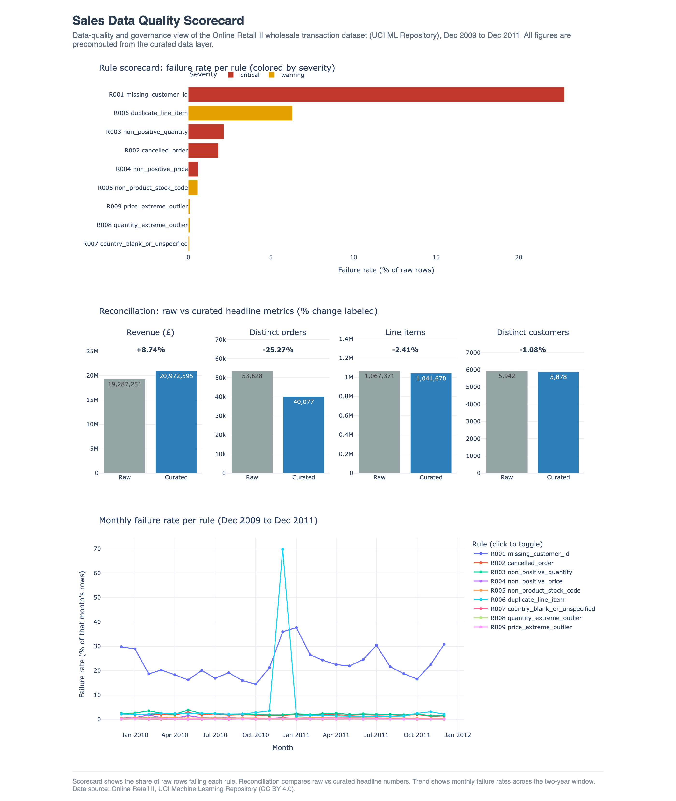

# Sales Data Quality Scorecard

A data quality and governance framework for a real wholesale sales transaction
dataset. It defines quality rules in a readable YAML catalog, applies them to
produce a trustworthy curated data layer, reconciles the curated numbers against
the raw data, and publishes an interactive scorecard. The goal is that anyone
using the curated data can trust it and see exactly what was done to it and why.

## Live dashboard

https://sneha0504.github.io/Sales_Data_Quality_Scorecard/
<!-- PAGES_URL -->

## Dashboard preview


<!-- SCREENSHOT -->

## Key findings

Based on 1,067,371 raw transaction rows (December 2009 to December 2011):

- **Cleaning raises revenue, not lowers it.** Removing cancellations and non-sale
  rows increased revenue from £19,287,250.57 to £20,972,594.57, a gain of 8.74%,
  because cancellations and returns carry negative amounts. The 25,701 excluded
  rows carried a net of negative £1,685,344.
- **Order counts fall sharply.** Distinct orders dropped from 53,628 to 40,077, a
  25.27% decrease, once cancellation invoices were removed.
- **Line items and customers barely move.** Line items fell 2.41% (to 1,041,670)
  and distinct customers fell 1.08% (to 5,878).
- **Almost a quarter of rows have no customer.** 243,007 rows (22.77%) are missing
  a Customer ID. These are kept and flagged, since many are valid guest or B2B
  sales, but they limit customer-level analysis.
- **Duplicates spike in late 2010.** Exact duplicate line items affect 6.30% of
  rows overall, with a large concentration in December 2010.

Full details are in the issue log, data dictionary, and data quality report under
`docs/`.

## How it works

1. **Load** the Online Retail II workbook into a SQLite warehouse.
2. **Profile** the raw table and write a data quality report.
3. **Run** the YAML rule catalog (9 rules) against the warehouse.
4. **Curate** the data by applying each rule's handling (exclude, flag, or keep
   with note), producing the curated line-item table and flag columns.
5. **Reconcile** raw vs curated headline numbers and verify an internal identity
   (curated plus excluded equals raw, for both row count and revenue).
6. **Build** a self-contained Plotly dashboard.

## Run it locally

Requires Python 3.11 or newer. The raw dataset is not committed; download it
first (see Data source below) and place `online_retail_II.xlsx` in `data/raw/`.

```sh
make setup       # create .venv and install pinned requirements
make all         # load, profile, run rules, curate, reconcile
make test        # run the pytest suite
make dashboard   # build docs_site/index.html
```

Then open `docs_site/index.html` in any browser. It is fully self-contained and
needs no server.

Other targets: `make load`, `make rules`, `make curate`, `make reconcile`,
`make clean`.

## Data source

- **Online Retail II**, UCI Machine Learning Repository.
- Page: https://archive.ics.uci.edu/dataset/502/online+retail+ii
- License: Creative Commons Attribution 4.0 International (CC BY 4.0).

Real transaction-level data from a UK-based online wholesale retailer.

## Tools and libraries

- Python 3.11+ with pandas and openpyxl (Excel loading)
- SQLite (via the Python standard library) as the rule-engine warehouse
- PyYAML for the rule catalog
- Plotly for the dashboard
- pytest for tests, ruff for linting
- Make for the pipeline, Git and GitHub CLI for version control and publishing
